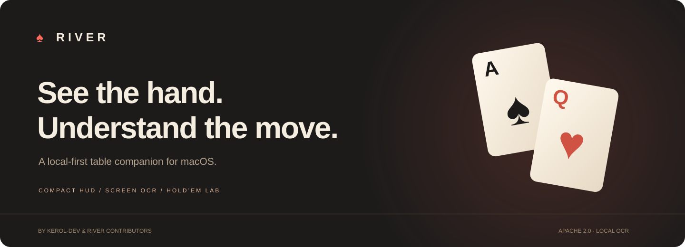
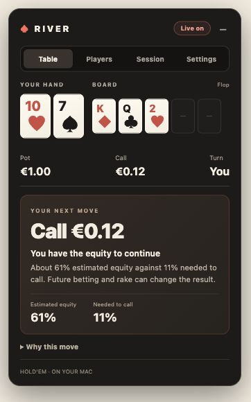
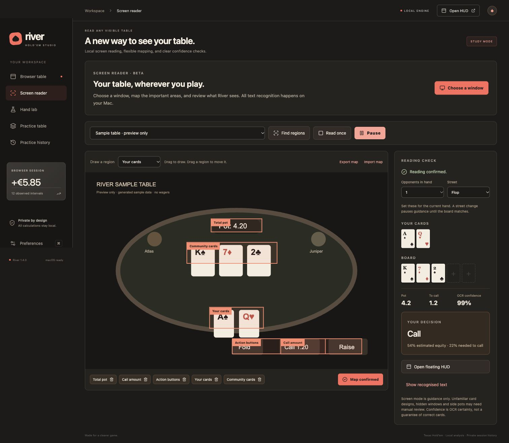

<p align="center"></p>

<p align="center">
  <a href="LICENSE"></a>
  
  
  <a href="https://github.com/kerol-dev/river/actions"></a>
</p>

<p align="center"><strong>Your hand. Your next move. Your session.<br>A small, private companion that keeps the important things in view.</strong></p>

<p align="center"><a href="#get-started">Get started</a> · <a href="docs/getting-started.md">Setup guide</a> · <a href="docs/compatibility.md">Compatibility</a> · <a href="CONTRIBUTING.md">Contribute</a></p>

---

## A quieter way to play and study

River combines a compact browser companion, a floating macOS HUD, a local Hold’em simulator and a mapped screen reader. It uses **warm charcoal `#1C1B1A`**, cream and coral, with clear card faces and plain-language explanations.

**All calculation and OCR happen on your Mac.** No cloud OCR, account credentials, hidden-card access or telemetry.

<table>
<tr><td width="54%">

### Everything has its place

- **Table:** readable cards, estimated win chance and the next decision. Win chance stays visible during opponents’ turns while the hand remains readable.
- **Players:** patterns from observed play, with uncertainty made explicit.
- **Session:** scrub the graph, compare 10-minute/hourly P/L, or start a fresh baseline without deleting history.
- **Settings:** mapping and optional bounded automatic runs.

The default reader view fits without scrolling at normal desktop heights. Details are available when you need them.

</td><td width="46%"></td></tr>
</table>

## Two ways to connect

|             | Browser adapter                                       | Screen reader · beta                                          |
| ----------- | ----------------------------------------------------- | ------------------------------------------------------------- |
| Input       | Visible elements in the supported Hold’em client      | A selected macOS app, browser window or display               |
| Setup       | Pair Chrome, then map table elements                  | Choose a window, review suggested regions, drag to adjust     |
| Recognition | Client-specific card and action parsing               | Local Apple Vision OCR with confidence and consistency checks |
| Guidance    | Equity, call price, suggested sizing, observations    | Card equity and call/check/fold comparison after validation   |
| Actions     | Optional user-started automation with explicit limits | Guidance only; no clicks or bet entry                         |

The current browser adapter targets the observed Bet365 Hold’em web client. **Screen capture is not tied to Bet365**, but recognition depends on the table design. Stylised suits, unclear amounts, protected windows and side pots can require manual review. River warns instead of filling gaps with guesses. See the [compatibility matrix](docs/compatibility.md).



_Screenshots use generated sample data. The OCR UI preview uses a mock source; the native recognition engine is separately exercised on generated image fixtures._

## Get started

### Develop locally

Requires **Node 24**. The macOS app’s OCR helper also requires **Xcode Command Line Tools** to build.

```sh
git clone https://github.com/kerol-dev/river.git
cd river
npm ci

# Build the local Apple Vision helper, then open the app.
npm run build:ocr
npm start
```

The repository is currently private; cloning requires access. The source is licensed under Apache-2.0.

For the web practice interface:

```sh
npm run dev
```

For a standalone macOS development build:

```sh
npm run package:mac
```

The app appears in `release/River-darwin-<architecture>/River.app`. Packaged users do not need Node or Swift. Builds are locally signed for development; a public Developer ID signed and notarized distribution is not yet provided.

### Connect Chrome

1. Load `browser-extension/` unpacked through Chrome’s extension manager.
2. In River, open **Browser table → Connection** and copy the pairing code.
3. Paste it into the extension, choose **Connect to River**, then **Start reader**.
4. Refresh the supported table between hands. Use the reader’s **Settings** tab to review mapping.

For another app, choose **Screen reader** in River. Select a window, review the suggested regions, set the current street and opponent count, confirm the map and start reading. macOS Screen Recording permission is required. The [setup guide](docs/getting-started.md) covers mapping, updates and troubleshooting.

## Built for understanding

- **Win chance before your turn.** Fresh, valid cards are analysed independently of whether action buttons are available. Ties and equity remain separate concepts: win chance is the probability of winning outright; equity includes your share of ties.
- **Transparent analysis.** Monte Carlo equity against unknown or labelled heuristic ranges, readable pot odds and explanations. No claim of GTO or guaranteed profit.
- **Stable cards.** Brief animations retain the last confirmed display without authorising stale actions.
- **Visible player patterns.** Local observations keyed by public usernames. Hidden-card bluff intent is never invented.
- **Session history.** Stable hand-boundary balances, cash-flow adjustments, archived resets and JSON export.
- **A private practice table.** Heads-up no-limit Hold’em with legal action bounds, split pots, all-in runouts and a statistical opponent.
- **A hand lab.** Explore boards, ranges and up to five opponents without a live table.

## Confidence before action

OCR mode requires mapped fields, exact readable ranks and suits, valid amounts and consistent frames. Uncertain reads pause guidance. A high OCR confidence score is not proof that a card is correct; review the detected state before acting.

Browser automatic mode is off by default. The user starts each bounded run with action, spend and duration limits. River rechecks the state immediately before one submission and stops if the client does not acknowledge it. It does not log in, join tables, buy chips or resume an inactive seat. Live automatic wagers are not part of the project’s automated verification. Use assistance only where the service permits it.

## Under the hood

```text
src/engine/          Hold’em rules, evaluation and equity worker
src/reader/          Browser validation, observations and accounting
src/screen/          Window mapping and conservative OCR parsing
browser-extension/  Scoped client adapter and compact companion
native/             Local Apple Vision text recognition
electron/           Sandboxed app, authenticated bridge and capture IPC
```

Read the [architecture notes](docs/architecture.md), [privacy and security notes](SECURITY.md), and [contribution guide](CONTRIBUTING.md).

### Verify a change

```sh
npm test
npm run build
npm run release:check

# macOS: exercise real OCR on a generated image and mapped crop.
npm run build:ocr
npm run test:ocr
```

Tests cover evaluation, chip conservation, reader confidence, all-in label handling, stale-state rejection, bounded automation on synthetic tables, session accounting, card presentation and OCR parsing. CI validates the app on Linux and macOS and runs native OCR checks on macOS. Coverage of one client or fixture does not establish compatibility with every poker room.

## What’s next

- More card-layout fixtures and community-contributed mappings.
- Broader screen-recognition validation across app designs.
- Signed and notarized public macOS releases.
- **Blackjack**, with its own rule variants and strategy engine, reusing the capture and mapping layers. It is not implemented in this release.

## Attribution and license

Created by **[kerol-dev](https://github.com/kerol-dev)** with River contributors.

River is licensed under the **[Apache License 2.0](LICENSE)**. When distributing forks or derivatives, preserve the relevant license, copyright and [NOTICE](NOTICE) attribution as the license requires. These notices may be retained in documentation or legal notices; the license does not require a promotional banner on every screen.

Third-party dependencies retain their own licenses. See [THIRD_PARTY_NOTICES.md](THIRD_PARTY_NOTICES.md). River is independent and is not affiliated with the operators of supported poker clients.
