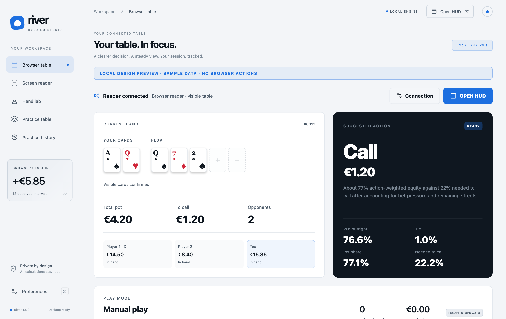

<p align="center"></p>

<p align="center">
  <a href="https://github.com/Kerol-Dev/river/releases/latest"></a>
  
  <a href="LICENSE"></a>
  <a href="https://github.com/Kerol-Dev/river/actions/workflows/ci.yml"></a>
</p>

<p align="center"><strong>Your hand. Your next move. Your session.<br>A private Hold’em companion for macOS and Windows that keeps the important things in view.</strong></p>

<p align="center"><a href="#download">Download</a> · <a href="docs/getting-started.md">Setup guide</a> · <a href="docs/compatibility.md">Compatibility</a> · <a href="CONTRIBUTING.md">Contribute</a></p>

---

River reads the poker table you are looking at, works out your win chance and the price of each decision, and explains its suggestion in plain words. It runs on **macOS and Windows**, connects to Chrome for browser tables, and reads any other window with local screen recognition.

**Everything runs on your computer.** No cloud OCR, accounts, hidden-card access or telemetry. The only network connection is between the Chrome extension and the River app on `127.0.0.1`.

<p align="center"></p>

## Download

Get the files from the **[latest release](https://github.com/Kerol-Dev/river/releases/latest)**:

| File                                   | For                                    |
| -------------------------------------- | -------------------------------------- |
| `River-<version>-mac-arm64.dmg`        | Macs with Apple silicon (M1 and later) |
| `River-<version>-mac-x64.dmg`          | Intel Macs                             |
| `River-<version>-windows-setup.exe`    | Windows 10 and 11 (64-bit)             |
| `River-<version>-chrome-extension.zip` | The Chrome table companion             |

- **macOS:** open the `.dmg` and drag River to Applications. Builds are not notarised yet, so the first time right-click River → **Open** → **Open**.
- **Windows:** run the setup. It installs for your user only, without an administrator prompt. The installer is not code-signed yet, so if SmartScreen warns choose **More info** → **Run anyway**. Closing the window keeps River in the notification area; quit it from the tray icon.
- **Chrome:** unzip the extension, open `chrome://extensions`, turn on **Developer mode**, choose **Load unpacked** and select the `browser-extension` folder. Then pair it with the code from River → **Browser table → Connection**.

## Three ways to read a table

<table>
<tr><td width="58%">

### Browser companion

A compact panel beside your table in Chrome, with **Table**, **Players**, **Session** and **Settings** pages.

- **Bet365** is read automatically with a dedicated reader: seats, players, bets, timers and sizing.
- **Any other site:** click the River button and choose **Use River on this site**. River finds your cards, the board, the pot, the live buttons and opponents’ face-down hands by itself. It understands cards written as text, labels, image names and card classes. Drag a marker to correct anything it gets wrong.
- Win chance, tie chance, pot share and the price to call stay visible while others act.

</td><td width="42%"></td></tr>
</table>

### Screen reader

For tables drawn as a single image, or in another app entirely. Choose a window and River does the rest in **Automatic** mode: it finds face-up cards by their shape, reads each rank, identifies each suit by colour and shape (including four-colour decks), sets the street from the board, and reads the pot and buttons from on-screen text. **Manual map** is there for unusual layouts.

Text recognition uses **Apple Vision** on macOS and the **built-in Windows OCR** on Windows. Card detection is the same on both.


### Desktop app

- **Floating HUD** that stays above your table window.
- **Hand lab** to explore boards, ranges and up to five opponents without a live table.
- **Practice table:** heads-up no-limit Hold’em against a statistical opponent, with fake chips.
- **Session history** with a scrubbable graph, 10-minute and hourly results, cash-flow corrections and JSON export.

## How River decides

- **Preflop** uses starting-hand ranges for the situation: nobody has raised, players limped, someone raised, or the pot is re-raised. Only players who actually raised or called count as opponents; players yet to act and posted blinds do not. For example, AQo raises first in and calls a single raise. If a call would commit a large part of your stack, only the strongest hands continue.
- **After the flop** River compares your equity, weighted by how opponents have bet, with the price of calling, then applies extra caution for weak made hands and draws.
- **Every suggestion is explained**, with the reasoning one click away. These are transparent heuristics, not a solver, and there is no guarantee of profit.

## New in 1.6

- **Windows 10 and 11:** native Windows 11 title bar, notification-area icon and Windows text recognition.
- **Any site** in the Chrome companion, with automatic table detection and a cleaner panel and popup.
- **Automatic Screen reader** that finds cards by shape instead of needing a drawn map.
- **Better preflop decisions** from starting-hand ranges.
- **New design:** a cool slate and blue palette with **light and dark themes**. Choose System, Light or Dark in Preferences, the extension popup or the panel’s Settings page.

## Confidence before action

River pauses rather than guessing. Guidance needs fresh, readable cards and amounts, and two matching readings in a row. Unusual card designs, hidden windows, side pots and all-in spots may need your own review.

Bet365 also offers an optional automatic mode that you start yourself with action, spending and time limits. It is off by default and is never available on other sites. Many real-money poker services prohibit assistance tools and automated play, so check the rules of the service you use.

## Build from source

Requires **Node 24**. On macOS the screen-reading helper also needs the **Xcode Command Line Tools**.

```sh
git clone https://github.com/Kerol-Dev/river.git
cd river
npm ci
npm start        # build and open River (macOS: run `npm run build:ocr` once first)
npm run dev      # web preview of the interface
```

Load `browser-extension/` unpacked in Chrome to use your local copy of the extension.

### Package and release

```sh
npm run package:mac        # .app and .dmg in release/ (RIVER_ARCH=arm64 or x64)
npm run package:win        # Windows app and setup .exe (needs Inno Setup 6)
npm run package:extension  # Chrome extension .zip
```

Pushing a `v*` tag runs the release workflow. It creates the GitHub release, then each build uploads its own file as soon as it is ready: both `.dmg` files, the Windows setup `.exe` and the extension `.zip`.

### Verify a change

```sh
npm test               # unit tests (both platforms)
npm run build
npm run release:check
npm run test:ocr       # macOS: Apple Vision text and card detection on generated tables
npm run test:ocr:windows  # Windows: Windows OCR on a generated table
```

CI runs on Linux, macOS and Windows. The release workflow also launches the packaged macOS and Windows apps before uploading them. Passing fixtures does not prove compatibility with every poker room.

## Under the hood

```text
src/engine/           Hold’em rules, evaluation and equity worker
src/reader/           Live decisions, preflop ranges, observations and session accounting
src/screen/           Screen reader: automatic reading and manual maps
src/study/            Offline range comparisons and hand review
browser-extension/    Bet365 reader, any-site reader, panel, popup and themes
electron/             Sandboxed app, local bridge, screen capture and card detection
native/               Apple Vision helper (macOS) and Windows OCR script
```

Read the [architecture notes](docs/architecture.md), [privacy and security notes](SECURITY.md) and [contribution guide](CONTRIBUTING.md).

## What’s next

- Position-aware preflop ranges.
- More card designs and table layouts in the test fixtures.
- Signed and notarised macOS builds and a signed Windows installer.

## Attribution and license

Created by **[kerol-dev](https://github.com/kerol-dev)** with River contributors.

River is licensed under the **[Apache License 2.0](LICENSE)**. When distributing forks or derivatives, preserve the license, copyright and [NOTICE](NOTICE) attribution as the license requires.

Third-party dependencies keep their own licenses; see [THIRD_PARTY_NOTICES.md](THIRD_PARTY_NOTICES.md). River is independent and is not affiliated with any poker operator.

_Screenshots use generated sample data._
