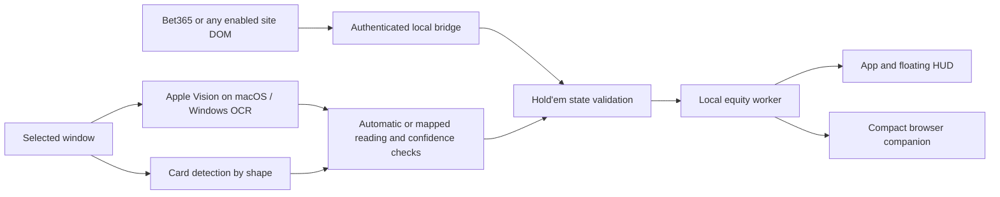

# Architecture

River keeps acquisition, validation, game analysis and UI separate.

## Input paths

**Browser adapters.** `adapter.js` reads the Bet365 client; `generic-adapter.js` detects cards, board, pot and buttons on any site the user enables, using the same snapshot format. `adapter.js` reads visible DOM nodes, normalises cards and action labels, and produces a stable decision key. `background.js` sends authenticated packets to the local bridge. The bridge validates field sizes, amounts, the extension origin and the session token. `useBrowserReader` owns observations, display smoothing, calculation and publication to the HUD.

**Screen reader.** `ScreenStudio` explicitly selects a source from Electron’s available window/display list. `screen-reader.cjs` validates source IDs and normalised regions, obtains a fresh image, and invokes the bundled Apple Vision helper. The helper returns text, bounding boxes and OCR confidence per region. Temporary images are removed in `finally`. `recognition.ts` parses exact cards and unambiguous amounts. Two consistent readings are required; fields below 85% OCR confidence, stale frames, malformed boards, ambiguous actions and unsupported all-in pots suppress guidance. OCR confidence is not a calibrated probability of a correct table state.

## Actions

The browser controller is user-started and bounded by action count, duration, incremental action cost and submitted-spend budget. It revalidates the current state before submission, sends one action and waits for acknowledgement. It does not rejoin or retry an unacknowledged action. Screen mode has no action dispatcher and cannot place bets.

## Storage and trust

Electron uses isolated, sandboxed renderers and a narrow preload. The browser bridge listens only on loopback. A selected-window screenshot exists in renderer memory and briefly in a private temporary directory. Exported maps contain only geometry and region labels. Browser sessions and public player observations are stored locally, not in the repository.

## Future games

Blackjack is planned, not implemented. Keep its deck/shoe assumptions, dealer state, legal actions, rule variants and strategy engine in a new game module. It can reuse source selection, region mapping, the OCR helper and confidence presentation. The Hold’em parser and equity engine must not interpret blackjack readings. Each additional game needs its own fixtures and explicit supported-rule matrix.

## Platforms

The Electron app runs on macOS and Windows. Screen text recognition uses the Apple Vision helper (`native/recognize.swift`) on macOS and `native/windows/recognize.ps1` (Windows.Media.Ocr) on Windows. Card detection runs in Swift on macOS and in `electron/card-detect.cjs` on Windows; both use the same reference shapes (`electron/card-templates.json`, exported with `river-ocr --templates`) and are tested against the same generated tables.

## Preflop decisions

`src/reader/preflop.ts` classifies the pot as unopened, limped, raised or re-raised from seat actions, counts only players who raised or called, and chooses from starting-hand ranges. Postflop decisions keep the equity-versus-price model in `src/reader/model.ts`.
